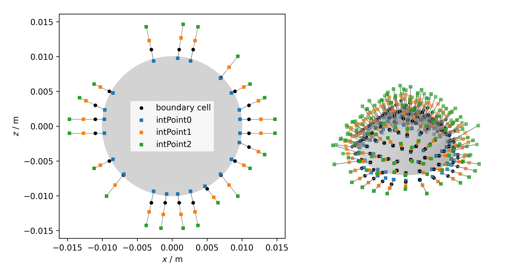

# ibfoamrig

**Immersed Boundary OpenFOAM Rig** is a Python library for managing and
post-processing OpenFOAM cases.

ibfoamrig was built to verify and validate the
[OpenHFDIB-RANS](https://github.com/LucieKubickova/openHFDIBRANS) solver
against body-fitted reference solutions such as `simpleFoam`. It reads
fields, function-object tables, residuals and IBM interpolation data into
[Polars](https://pola.rs) frames and plots them with matplotlib.

<p align="center">
  
</p>

## Installation

Requires Python 3.12 or newer.

```bash
pip install ibfoamrig
# or
pip install git+https://github.com/vecerniv/ibfoamrig.git
```

## Example

Plot the IBM interpolation lines around an immersed sphere:

```python
import ibfoamrig as ifr
from ibfoamrig.plot import finish_figure, plot_geometry_3d

case = ifr.FoamCase("tests/data/3d_hfdibrans")
cells = case.fields_at(["U"])
info = case.interpolation("ZZ_python/interpolationInfo_boundary.dat", cells)

ax = plot_geometry_3d(
    info,
    color_by="yOrtho",
    points=True,
    surface=case.surface("constant/triSurface/sphere.stl")
)
finish_figure(ax.figure, show=True)
```

## Documentation

The [documentation](https://vecerniv.github.io/ibfoamrig) covers:

- **API reference**: every public class and function, with Google-style
  docstrings.
